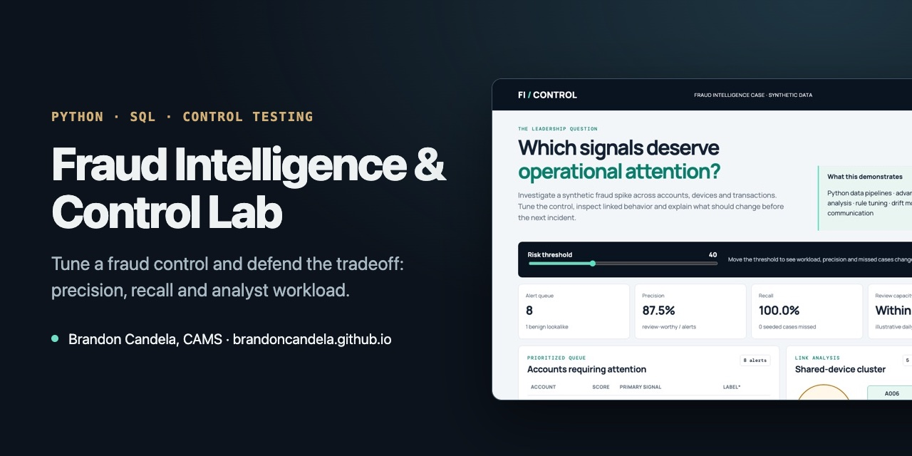

# Fraud Intelligence & Control Effectiveness Lab



**[▶ Open the live demo](https://brandoncandela.github.io/fraud-intelligence-control-lab/)** · [Portfolio](https://brandoncandela.github.io/) · [LinkedIn](https://www.linkedin.com/in/brandon-candela/) · Built by Brandon Candela, CAMS

> **What this shows:** Python and SQL feature engineering, control tuning with precision/recall tradeoffs, link analysis and an executive-ready recommendation.

A fraud investigation case by [Brandon Candela](https://brandoncandela.github.io/) using **Python, SQL, graph/link analysis and control-effectiveness metrics** to investigate synthetic fraud behavior.

## The business problem

A payments platform sees a possible fraud spike. Which accounts should enter the review queue? Which signals form a coherent incident pattern? How should the team change the control without overwhelming analysts or treating a single shared attribute as proof?

The browser demo lets a reviewer tune the risk threshold, observe changes in alert volume, precision and recall, inspect a shared-device cluster, review control health and export an incident recommendation.

## Technical work

- Python creates a deterministic synthetic dataset and reproducible SQLite database.
- SQL uses CTEs, joins, time windows and aggregations to engineer account-level features.
- The dashboard exposes threshold tradeoffs, a relationship graph, incident reconstruction and data-quality monitoring.
- Seven tests verify referential integrity, seeded scenarios, threshold tradeoffs and export consistency.

## Repository map

- `src/generate_lab.py` — synthetic data pipeline and dashboard export
- `sql/schema.sql` — relational model and indexes
- `sql/account_features.sql` — inspectable feature engineering
- `tests/test_lab.py` — pipeline and scenario validation
- `dist/` — public interactive work sample

## Run locally

```bash
python3 src/generate_lab.py
python3 -m unittest discover -s tests -v
python3 -m http.server 8000 --directory dist
```

Then open `http://localhost:8000`.

## Design decisions and validation

- **Scenarios:** a five-account shared-device cluster, two account-takeover patterns and benign household/merchant lookalikes make a review queue more useful than a list of uniformly suspicious examples.
- **Thresholds:** inspect `src/generate_lab.py`: the illustrative score combines device peers ×12, distinct inbound senders ×4, rapid outbound dollars /500 and new foreign-device dollars /350, capped at 100. The browser threshold selects accounts; this score is not a probability.
- **Tradeoffs:** shared infrastructure and marketplace settlement can be legitimate. Tightening the threshold changes account-level capture and workload; it does not establish the cause of an incident. The sender feature is a maximum calendar-day count, not a true rolling 24-hour count.
- **Validation:** tests cover seeded scenarios, integrity, threshold tradeoffs and export consistency. Outcomes are authored synthetic account labels. There is no independent production holdout, and the displayed control-health series is illustrative rather than operational telemetry.
- **AI assistance:** AI coding tools assisted implementation and documentation. The public evidence of the work is the Python pipeline, SQL features, tests and demo. This section does not assign unverified personal authorship or employer results.

## Scope and limitations

All people, devices, transactions and outcomes are made up. The scoring weights are illustrative, not calibrated probabilities. A shared device, fast timing or concentrated activity is a lead to check, not proof of fraud. Putting a control like this into production would also need real outcome data, fairness and privacy review, ongoing monitoring and change approval.

Built with AI coding tools.
